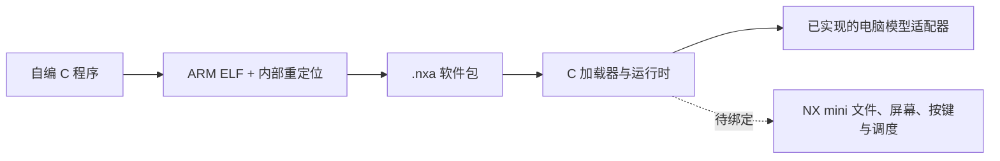

# 自定义软件与黄金矿工：A01

2026-10-19 已完成可复现的 ARM 软件包、C 加载器、协作式运行时，以及黄金矿工玩法的原创简化 C 实现。编译出的同一份 ARM 二进制已在电脑上的 Unicorn 中运行，正常按键可连续完成五关。**尚未接入相机启动／菜单入口，未在 NX mini 屏幕上运行，没有生成包含它的可刷固件。**

## 路线结论

本机的固件证据支持 REALOS/ARM、ITRON 实时系统，见 [系统识别记录](../research/generated/os-platform-evidence.json)。现有工程没有 Linux 内核、进程命名空间、Docker 运行环境或厂商应用 SDK。这里选择“原生 ARM 模块 + 小型加载器”，以便编译自己的 C 软件；并未实现 Linux 容器，也没有证据证明 `autoexec.sh`、`nolens.txt` 能启动任意程序。

加载器处理 `.nxa` 文件，检查格式、接口版本、固件适配档案、长度、CRC 和重定位表，将镜像复制到调用方提供的内存，清零 BSS，并修正内部指针。运行时接着调用平台缓存同步、获取显示区域，在独立栈上调用程序，再由外层逐帧提供按键和时间，最后释放显示区域。程序通过 `INIT / FRAME / STOP` 返回控制权。

这些是**受信任的原生插件**：没有 MMU 安全沙箱、恶意代码隔离或实机抢占式超时机制。CRC 用于发现损坏，不是签名。适配档案中的 SHA-256 是接口基线标识，不是由相机运行时重新读取整包固件计算的证明。C05／C06 等派生固件必须逐一核对接口兼容性，不能仅凭档案相同就宣称适配成功。



## 当前证据

所有原厂地址均以官方 1.10 的解压段 1 静态映射 `0x40000000` 为前提，未读取机身内存确认。原厂二进制只在本地分析，反编译代码没有复制到新增源码。

| 接口 | 发现与验证 | 剩余边界 |
| --- | --- | --- |
| 文件打开 `0x4035756c` | 执行原指令，模拟底层返回 7、0、-1；负错误被包装为 0 | 原厂真实文件系统、盘符、互斥和 SD 访问仍未执行；0 句柄有歧义 |
| 文件读取 `0x403575f4` | 原指令从底层 `r3` 指向的栈变量取实际读取数，验证整读／短读／空读 | 不应照搬反编译器推导出的“总是返回 0”；必须检查完整长度 |
| 文件关闭 `0x403577b4` | 非零句柄下，即使模型底层报错，包装器也返回 1 | 关闭成功不能作为装载完整性的依据 |
| 任务创建 `0x4007db1a` | 原厂任务类调用此 Thumb 包装器，涉及栈分配和任务入口 | 优先级、启动／退出、调度和相机 UI 生命周期未验证 |
| 命令分发 `0x40288f34` | 字符串命令与已注册处理函数分发 | 不是已验证的存储卡自动执行入口 |
| `CGuiCanvasImpl` 虚表 `0x4076fef0` | RTTI 和函数指针对应；执行 `0x406a07e8` 初始化、`0x406a0854` 非零清屏、`0x406a09e8` 矩形写入 | 使用模型 RAM 和模型互斥；没有实际显示提交 |
| 原厂画布布局 | 宽 `+4`、高 `+8`、步长字节数 `+0xc`、总长度 `+0x10`、缓冲指针 `+0x14`；像素为 32 位写入 | 色彩通道顺序、透明度、真实缓冲所有权和双缓冲提交未确认 |
| CPU 缓存同步 | 新代码执行需要正确的指令／数据缓存同步 | `0x4018435c` 的 `cacheFlush` 涉及资源／分配器管理，不能仅凭名称绑定为 CPU 缓存函数 |

机器记录：[文件包装器](../research/generated/custom-app-file-wrappers.json)、[画布](../research/generated/custom-app-canvas.json)。[平台档案](../firmware/apps/platform/nxmini-110.json) 保持禁用，未绑定接口不会启动运行时。

段 1 的固定压缩槽只有 **404 字节**官方对齐余量。解压段中虽然存在较大的全零区域，但不能据此认定其启动后仍可占用。把 2,608 字节加载器放入该区域的[体积实验](../research/generated/custom-app-loader-size.json)表明，两种编码策略分别增加 2,150／2,099 字节，均超出原槽。这只作离线尺寸评估，不增加入口、不写固件候选。后续可以研究精简一级装载桩、复用已证实可替换的原厂代码区，或在理解启动映射后支持段重布局。不能让现有重组器越界覆盖下一段。

## 黄金矿工

游戏独立实现摆钩、下钩、碰撞、按重量回收、金币累计、炸药、暂停、超时重试和五关目标。画面与简单字体由 C 代码绘制，没有使用原版 Flash、商用素材、音效或原版源码。当前没有声音和存档。

| 项目 | A01 |
| --- | --- |
| 指令集 | ARMv5TE ARM 状态、小端、AAPCS32、软件浮点；是兼容目标选择，不是对机身确切 CPU 型号的鉴定 |
| 包大小 | 5,128 字节，22 处内部 ABS32 重定位 |
| 程序镜像 | 4,912 字节，BSS 为 0 |
| 加载器与运行时镜像 | 2,608 字节，另需平台适配和固件入口 |
| 游戏私有状态 | 申请 1,024 字节，当前结构实际 328 字节 |
| 程序独立栈 | 8,192 字节 |
| 逻辑画面 | 320 × 240、RGB565、153,600 字节；不是已经确认的机身 LCD 布局 |
| 基础合计 | 程序、状态、栈和逻辑画面共 167,728 字节，另需加载器、包缓存、平台开销和原厂画布转换空间 |
| 输入 | 逻辑 FIRE、BOMB、PAUSE、BACK；机身物理按键编号尚未绑定 |

电脑预览执行 `.nxa` 内的 ARM 指令，包含 C 运行时与独立栈切换。Python 只提供模型文件读取、屏幕、键盘和时间；并非另写了一份 Python 游戏。预览的缓存同步回调是模型，不能验证真实 CPU 的缓存行为。Unicorn 的指令预算也不等同于相机看门狗。

## 使用与复现

本工作区可双击 `dist/nxmini-apps-A01/play-gold-miner.cmd`，或运行：

```powershell
Set-Location 'D:\NX mini evo'
.\.venv\Scripts\python.exe tools/play_gold_miner.py --build dist/nxmini-apps-A01
```

空格／Enter 下钩或继续，↑ 使用炸药，P 暂停，Esc 退出。首次是标题画面。预览按整数三倍显示，不代表实机分辨率或性能。

重新构建到新目录：

```powershell
.\.venv\Scripts\python.exe tools/bootstrap_app_toolchain.py
.\.venv\Scripts\python.exe tools/build_apps.py --output work/apps-rebuild
.\.venv\Scripts\python.exe tools/verify_apps.py work/apps-rebuild --output work/apps-rebuild/validation.json --preview work/apps-rebuild/previews
.\.venv\Scripts\python.exe tools/research_apps.py --build work/apps-rebuild
.\.venv\Scripts\python.exe -m pytest -q tests/test_apps.py
.\.venv\Scripts\python.exe tools/play_gold_miner.py --build work/apps-rebuild
```

需要 Python 3.11+、`unicorn==2.1.4`、Pillow，GUI 还需要 Tk。工具链引导脚本只在 `tools/local` 提取固定的 Arm GNU Toolchain 14.3.rel1，核对 Arm 发布的 ZIP SHA-256，不修改系统 PATH。其他系统可通过 `NXE_ARM_GCC` 指向兼容编译器，但不同编译器版本的产物哈希可能不同。

已有构建目录只有带本工具 `.nxe-build` 标记时才可加 `--rebuild` 覆盖。构建器没有刷写或写卡动作。`.nxa` 也不是 `DATANXmini.bin`，当前复制到卡里不会自动执行。

编译其他自定义软件时，实现同一个 `nxe_app_entry` 接口，然后指定自己的源文件和资源预算；多个源文件重复传入 `--source`：

```powershell
.\.venv\Scripts\python.exe tools/build_apps.py --source my_tool.c --app-id my_tool --state-bytes 1024 --stack-bytes 8192 --output work/my-tool-build
```

输出包含 `my_tool.nxa`、ARM ELF 和符号表。当前打包器只支持 C 与 ARM 汇编，不提供 C++ 标准库、动态链接、外部库导入或固件私有函数的直接绑定。

## 软件接口与包格式

入口 `int nxe_app_entry(NxeHost *host)`，宿主提供逻辑像素缓冲、按钮、按下边沿、毫秒间隔、私有状态和事件。程序不可保留每帧栈上的指针；持久状态放在 `host->state`。本游戏每帧最多处理 100 ms，超大时间间隔被截断，因此当前实现需要稳定调度，不能当作精确墙钟计时器。

`firmware/apps/include/nxe_app.h` 定义应用接口；`runtime/nxe_runtime.h` 定义平台回调与工作区。平台必须提供完整读取、获取／提交／释放画面、CPU 缓存同步，以及所声明的可执行内存、输入和调度能力。调用方须将 `NxeSession` 清零初始化，提供互不重叠的包／镜像／状态／栈缓冲，停止后才可重用。运行时退出和异常显示提交会触发 STOP 与显示释放；真正的相机模式恢复须由适配器实现。

NXA1 固定头 128 字节，小端：

| 偏移 | 内容 |
| --- | --- |
| `0..7` | `NXA1`、u16 格式版本 1、u16 头长 128 |
| `8..43` | u32 ABI、架构、标志、镜像长度、BSS 长度、入口偏移、重定位数量、状态长度、栈长度 |
| `44..47` | 标准 CRC32；计算整个包时此字段视为零 |
| `48..79` | 32 字节固件适配档案标识 |
| `80..111` | 小写 ASCII 应用 ID，零终止并填零 |
| `112..127` | 保留，必须为零 |
| `128..` | 镜像字节，其后为严格递增、对齐的 u32 ABS32 重定位偏移 |

上限：镜像 128 KiB、BSS 64 KiB、4,096 个重定位、状态 8 KiB、独立栈 32 KiB。格式版本、模式、入口、指针、重复重定位、尾随数据或 CRC 不符均拒绝。宿主 Python 解析器与编译后的 C 加载器独立实现并交叉核对。ELF 打包只接受已实现的内部 ARM 重定位，拒绝导入、硬浮点和未知类型。

## 实机接入尚待完成

1. 确认可以占用的代码位置与启动／菜单挂钩，解决固定压缩槽容量。
2. 确认可执行 RAM 的所有权、生命周期与 CPU 缓存同步方法。
3. 将 RGB565 逻辑画面转换到原厂 32 位画布，核实颜色／透明度、显示提交和退出恢复。
4. 接通真实按键派发与协作调度，避免快门、拍摄、写卡或模式切换同时访问 UI 资源。
5. 用机身先运行可退出的最小图形程序，再验证黄金矿工。这些仍需要实机证据，当前电脑模型不能替代。

## 参考

- [Samsung NX Hacks 的 M7MU 格式研究](https://github.com/ge0rg/samsung-nx-hacks/wiki/M7MU-Firmware-Format)：格式和平台背景；本地地址及行为以官方 1.10 原字节为准。
- [Arm AAPCS32](https://github.com/ARM-software/abi-aa/blob/main/aapcs32/aapcs32.rst)：调用约定和栈对齐。
- [Arm：Caches and Self-Modifying Code](https://developer.arm.com/community/arm-community-blogs/b/architectures-and-processors-blog/posts/caches-and-self-modifying-code)：说明加载新代码前的缓存同步要求；不能直接把 Linux 的系统调用用到 REALOS。
- [Arm GNU Toolchain 安装文档](https://learn.arm.com/install-guides/gcc/arm-gnu/)：本地编译工具链来源。
